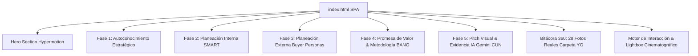

# 📋 BITÁCORA Y DOCUMENTACIÓN INTEGRAL DE LA SOLUCIÓN
# MARCA PERSONAL • ALDAIR ENRIQUE CAMARGO VILLALOBOS ("KIKE JUNIOR")
> **Corporación Unificada Nacional de Educación Superior (CUN)**  
> **Asignatura:** Proyecto de Vida (ACA)  
> **Programa Académico:** Ingeniería de Sistemas  
> **Estudiante:** Aldair Enrique Camargo Villalobos  
> **Docente / Guía:** Corporación Unificada Nacional CUN  
> **Repositorio Oficial:** [github.com/enrique-camargo/marca-personal](https://github.com/enrique-camargo/marca-personal)  
> **Última Actualización:** 2026-10-20  
> **Estado:** Activo y en sincronización continua  

---

## 📌 0. REGLA PERMANENTE DE ACTUALIZACIÓN
> **COMPROMISO DE TRAZABILIDAD:**  
> Cada vez que se agregue una nueva función, se modifique un módulo, se cambie el diseño, se carguen fotos o se corrija código en este proyecto, **este documento (`BITACORA_SOLUCION.md`) debe actualizarse obligatoriamente**, registrando los cambios en la sección de [Historial de Cambios y Versiones](#-historial-de-cambios-y-versiones-changelog) y ajustando la sección temática correspondiente.

---

## 🎯 1. CONTEXTO GENERAL DEL PROYECTO

### 1.1 Propósito Académico y Profesional
El proyecto consiste en el diseño, desarrollo e implementación de la **Marca Personal Digital** de **Aldair Enrique Camargo Villalobos ("Kike Junior")**, integrando de manera sinérgica sus dos grandes pasiones y pilares de vida:
1. **El Deporte de Alto Rendimiento (Voleibol):** Capitán y colocador (*setter*), aportando visión periférica, anticipación táctica, liderazgo bajo presión y armado de juego.
2. **La Ingeniería de Sistemas:** Automatización de procesos empresariales, desarrollo de software, gestión de infraestructura/servidores y aplicación ética de Inteligencia Artificial.

### 1.2 Filosofía de Diseño: "De la Cancha al Código"
La web no es un simple currículum estático; es una **Single Page Application (SPA)** inmersiva diseñada con estética **Dark Tech & Sports Strategy (Hypermotion Edition)**:
* Paleta cromática: `slate-950` (profundidad cyber), `cyan-400` (precisión tecnológica), `emerald-400` (vitalidad y rendimiento atlético) y acentos púrpura/ámbar.
* Tipografías modernas: `Outfit` (títulos y acentos), `Space Grotesk` (cuerpo técnico) y `JetBrains Mono` (telemetría y código).
* Interactividad viva: GSAP 3, ScrollTrigger, 3D Magnetic Tilt, Canvas de partículas cyber y Lightbox cinematográfico 360°.

---

## 🧩 2. ESTRUCTURA COMPLETA DE LA SOLUCIÓN (MÓDULO POR MÓDULO)



---

### 2.1 Hero Section: Portada y Primera Impresión (Hypermotion Live)
* **Lema Central:** *"Conecto personas, automatizo procesos y estructuro soluciones tecnológicas con la precisión estratégica de un colocador en la cancha."*
* **Badge Táctico:** Indicador de estado en tiempo real (`Colocador & Tech Lead • CUN 2026`).
* **Live Story Reel (3 Cards de Acceso Rápido):**
  1. *En Cancha:* Fotografía de Kike en pleno salto/armado de voleibol.
  2. *En Oficina (Chapman Wilches):* Fotografía real en su puesto tecnológico.
  3. *En Viajes:* Fotografía de equilibrio personal en la naturaleza.
* **Pills de Competencia:** `#IngenieríaDeSistemas`, `#Automatización`, `#VoleibolSetter`, `#ResoluciónDeProblemas`.

---

### 2.2 Fase 1: Autoconocimiento Estratégico (ACA Fase 1)
Desarrollo profundo de introspección personal y profesional:
* **¿Quién Soy?:** Esencia orientada a la lógica, los deportes, la informática y la superación continua.
* **Test Oficial IKIGAI (Visualización Directa):**
  * Gráfico original renderizado en tarjeta destacada (`assets/IKIGAItest.png`).
  * **YO AMO (Pasión y Propósito):** Resolver problemas y tareas complejas usando habilidades analíticas naturales para ver resultados directos y tangibles.
  * **SOY BUENO PARA (Fortalezas):** Interactuar con computadoras, procesar información, organizar, planificar, priorizar y actividad física de alto rendimiento.
  * **EL MUNDO NECESITA (Vocación & Impacto):** Ingeniería, tecnología, matemáticas, telecomunicaciones y servicio técnico humano.
  * **Arquetipo & Rareza:** *Técnico Analista* • *Astucia Independiente*.
  * **Acción interactiva:** Clic en la imagen para abrir en modal ampliado de alta resolución con descripción guiada.
* **Retos Personales y Plan de Mejora:** Reconocimiento de la dificultad para decir 'no' ante solicitudes múltiples, con plan de mitigación basado en matrices Eisenhower y delimitación de alcance.
* **Medidor de Dimensiones CUN:**
  * *Dimensión Altamente Desarrollada (90%):* Cognitiva, Lógica-Matemática y Visión Espacial.
  * *Dimensión a Fortalecer (60%):* Hábito Lector Continuo e Inteligencia Intrapersonal.
* **5 Habilidades Distintivas:**
  1. *Liderazgo Táctico (Mentalidad de Colocador):* Armar el juego para que el rematador brille.
  2. *Resolución de Problemas:* Descomposición algorítmica de fallos complejos.
  3. *Automatización de Procesos:* Eliminación de fricciones repetitivas mediante código.
  4. *Organización Estructural:* Trazabilidad y arquitectura limpia de sistemas.
  5. *Escucha Activa y Negociación:* Comunicación asertiva en entornos multidisciplinarios.

---

### 2.3 Fase 2: Planeación Interna - Objetivos SMART Reales (ACA Fase 2)
Basados en la realidad laboral y académica de Kike Junior:
* **Showcase con Fotografía Real:** Foto de Kike en Chapman Wilches con telemetría visual de servidores y procesos.
* **Meta Central Integral:**
  1. **Soluciones Corporativas:** Diseñar, desarrollar e implementar **4 soluciones tecnológicas** para automatizar, digitalizar y gestionar diferentes procesos en Chapman Wilches, garantizando trazabilidad total.
  2. **Infraestructura:** Liderar la actualización y repotenciación integral de los **servidores corporativos** de la firma.
  3. **Formación Académica:** Culminar con éxito los **3 ciclos propedéuticos** de Ingeniería de Sistemas en la CUN, con formación permanente y certificada en buenas prácticas de Inteligencia Artificial.
* **Desglose de Criterios SMART:**
  * **S (Específico):** 4 herramientas digitales con firma/trazabilidad, migración de servidores y titulación CUN.
  * **M (Medible):** Reducción de tiempos manuales en un 60%, 99.9% uptime de servidores, 100% materias aprobadas.
  * **A (Alcanzable):** Aplicando infraestructura existente, frameworks web modernos y asesoría técnica directa.
  * **R (Relevante):** Conecta el avance profesional con el ascenso y valor agregado directo en su empleo.
  * **T (Temporal):** Planificado en sprints trimestrales a 6 y 12 meses.

---

### 2.4 Fase 3: Planeación Externa - Buyer Personas Reales (ACA Fase 3)
Sistema interactivo de pestañas con dos arquetipos auténticos:
* **A) Perfil Corporativo: Dra. Mirna Wilches (Representante Legal - Firma Chapman Wilches)**
  * *Dolor Crítico:* Firma física a papel y lápiz de documentos jurídicos, riesgo de extravío, demoras operativas y falta de trazabilidad.
  * *Solución Propuesta por Kike:* **App de Firma Digital y Gestión Documental Certificada** con opciones parametrizadas de **Aprobación**, **Suspensión** y **Abstención**, con auditoría de cambios y log cronológico.
* **B) Perfil Familiar y Bienestar: Claudia Villalobos (Mamá de Kike Junior)**
  * *Fotografía Real:* Foto entrañable de Kike junto a su madre Claudia.
  * *Dolor Crítico:* Dificultad para planificar menús saludables, control deficiente de la despensa doméstica y falta de seguimiento histórico de hábitos sanos.
  * *Solución Propuesta por Kike:* **NutriTrack Home App**, aplicación móvil con recetario saludable, semáforo de inventario en alacena y gráficas de progreso de bienestar familiar en el tiempo.

---

### 2.5 Fase 4: Promesa de Valor & Metodología BANG (ACA Fase 4)
* **Fórmula de Promesa de Valor Oficial CUN:**
  > *"Yo, **Aldair Enrique Camargo (Kike Junior)**, sé **estructurar, desarrollar y automatizar soluciones tecnológicas**, para **equipos de desarrollo y organizaciones que buscan eficiencia y orden**, con **la visión estratégica, agilidad mental y liderazgo colaborativo de un colocador en la cancha de voleibol**."*
* **Split Interactivo "De la Cancha al Código":**
  * Lado A (Cancha): Foto de colocador armando juego táctico.
  * Lado B (Código): Foto en estación de trabajo programando soluciones.
* **Aplicación Oficial de la Metodología BANG:**
  * *Problema Analizado:* Fricción en firmas jurídicas manuales en papel.
  * *Jerarquía de Maslow:* **Necesidades de Seguridad** (certeza jurídica, no repudio y protección de datos).
  * *Guía Arquetípica:* **Cesia** (orden, rigor, blindaje y estructura).
  * *Tarjeta BANG:* *"Rompe los Miedos: Elimina la fricción operativa y crea confianza indestructible."*
  * *Acción Disruptiva:* **"LegalSign & Track 360: De la Cancha al Código"**.

---

### 2.6 Fase 5: Pitch Visual & Evidencia de Uso Ético de IA (ACA Fase 5)
* **Pitch Visual Ejecutivo:** Presentación tipo elevator pitch de 60 segundos orientada a empleadores y socios estratégicos.
* **Uso Ético de IA Generativa:**
  * *Herramienta Institucional:* Google Gemini (cuenta CUN).
  * *Registro de Prompts:* Documentación de directrices para refinamiento de textos y esquemas.
  * *Reflexión Crítica (140 palabras exactas):* Declaración de autoría, ética profesional y pensamiento crítico, donde la IA funge como asistente de aceleración y el estudiante ejerce la decisión y criterio técnico final.

---

### 2.7 Bitácora Multimedia 360° (`#galeria-360`)
Galería dinámica con **28 fotografías auténticas** extraídas de la carpeta personal `YO`:
* **🏐 Voleibol Táctico (4 fotos):** Campeonatos, armado en salto, trofeos y sinergia de equipo.
* **💻 Laboral & Sistemas (2 fotos):** Servidores y puesto de trabajo en Chapman Wilches.
* **🌍 Viajes & Equilibrio (12 fotos):** Rutas, naturaleza, montañas y momentos de reflexión.
* **👨‍👩‍👧 Familia & Raíces (4 fotos):** Celebraciones familiares y momentos con su madre Claudia Villalobos.
* **👶 Niñez & Orígenes (6 fotos):** Primeros años de vida, donde nació la pasión por el deporte y la curiosidad técnica.
* **Filtros Interactivos:** Botones con iconos y badges de conteo que filtran las fotos instantáneamente mediante JavaScript.
* **Lightbox Cinematográfico:** Al hacer clic en cualquier foto, se abre el visor modal con imagen en alta calidad, título, descripción, contador y flechas de navegación previa/siguiente.

---

## 🛠️ 3. ARQUITECTURA TÉCNICA Y COMPONENTES

| Componente | Tecnología | Propósito |
| :--- | :--- | :--- |
| **Estructura** | HTML5 Semántico | SPA con accesibilidad, etiquetas meta y jerarquía limpia. |
| **Estilos & Diseño** | Tailwind CSS (CDN) | Utilidades de micro-espaciado, gradientes oscuros y paleta personalizada. |
| **Animación Base** | GSAP 3 & ScrollTrigger | Animación de entrada por scroll (*reveals* y *stagger* cinemático). |
| **Micro-interacciones 3D** | Vanilla JavaScript | 3D Magnetic Tilt en tarjetas con cálculo de ángulos en `mousemove`. |
| **Efectos de Partículas** | HTML5 Canvas API | Lienzo en segundo plano con nodos cyber interconectados flotantes. |
| **Tipografía** | Google Fonts | `Outfit`, `Space Grotesk`, `JetBrains Mono`. |
| **Iconografía** | FontAwesome 6 Free | Íconos de voleibol, código, servidores, familia, viajes y controles. |
| **Visor Modal (Lightbox)** | JavaScript Nativo | Modal único flotante con navegación secuencial, soporte táctil y teclado (`Esc`, `←`, `→`). |
| **Despliegue & Git** | GitHub Pages / Repo | Control de versiones distribuido con script `actualizar.bat`. |

---

## 📂 4. ESTRUCTURA DE ARCHIVOS DEL PROYECTO

```text
c:\CUN\Proyecto de VIDA\ACA\KIKE JUNIOR\
│
├── .gitignore                      # Exclusiones de Git
├── README.md                       # Documentación introductoria del repositorio
├── BITACORA_SOLUCION.md            # [ESTE ARCHIVO] Documentación integral y registro continuo
├── actualizar.bat                  # Script interactivo de un solo clic para Git Add, Commit y Push
├── index.html                      # Single Page Application completa (código fuente unificado)
│
└── assets/                         # Directorio de recursos estáticos
    ├── IKIGAItest.png              # Gráfico oficial del Test IKIGAI
    ├── yo/                         # Galería fotográfica auténtica (28 fotos)
    │   ├── Voleibol/               # 4 fotos deportivas
    │   ├── Laboral/                # 2 fotos en Chapman Wilches
    │   ├── Familia/                # 4 fotos familiares y madre
    │   ├── Viajes/                 # 12 fotos de viajes y naturaleza
    │   └── Ninez/                  # 6 fotos de infancia y orígenes
```

---

## 📜 5. HISTORIAL DE CAMBIOS Y VERSIONES (CHANGELOG)

### [Versión 3.2] - 2026-10-20
* **Agregado:** Creación formal de la bitácora integral del proyecto (`BITACORA_SOLUCION.md`) como fuente de verdad y registro de todas las decisiones, arquitecturas y módulos.
* **Regla Establecida:** Obligatoriedad de registrar cualquier actualización futura en este documento.

### [Versión 3.1] - 2026-10-20
* **Corregido:** Visualización directa y destacada del gráfico del **Test IKIGAI** (`assets/IKIGAItest.png`) en la Fase 1, con tarjeta estética, desglose de resultados (Yo Amo, Soy Bueno Para, El Mundo Necesita) y botón de ampliación.
* **Corregido:** Reparación del modal Lightbox (`openImageModal` y `openGalleryLightbox`). Se eliminó un bloque duplicado de HTML que creaba IDs duplicados y causaba errores `null reference` en la consola.
* **Mejorado:** Asignación de `z-index: 9999` y backdrop-blur al visor modal, agregando soporte de navegación con teclas de flecha (`←`, `→`) y cierre con `Esc`.
* **Sincronizado:** Subida limpia y exitosa al repositorio GitHub (`commit 3350e84`).

### [Versión 3.0] - 2026-10-20
* **Agregado:** Integración completa de la carpeta `YO` con **28 fotografías reales** en alta definición.
* **Agregado:** Creación de la sección **Bitácora Multimedia 360°** (`#galeria-360`) con 5 categorías filtrables: *Voleibol*, *Laboral*, *Viajes*, *Familia* y *Niñez*.
* **Agregado:** Implementación del **Split Interactivo "De la Cancha al Código"** en la Promesa de Valor.
* **Agregado:** Canvas interactivo de partículas cyber dinámicas con estela reactiva.
* **Agregado:** Efecto 3D Magnetic Tilt en tarjetas interactivas de evidencia y objetivos.

### [Versión 2.0] - 2026-10-20
* **Agregado:** Integración de los datos reales del 2do Avance ACA:
  * Objetivos SMART reales: 4 soluciones corporativas, servidores Chapman Wilches y 3 ciclos propedéuticos CUN.
  * Buyer Personas reales: Dra. Mirna Wilches (Firma Digital) y Claudia Villalobos (NutriTrack Home).
  * Promesa de valor basada en la analogía del colocador de voleibol.
  * Reflexión ética del uso de IA (Gemini CUN) ajustada al estándar institucional de 140 palabras.
* **Agregado:** Script automatizado `actualizar.bat` con soporte UTF-8 para commit y push directos.

### [Versión 1.0] - 2026-10-20
* **Inicial:** Estructura inicial de Single Page Application para Proyecto de Vida (ACA) CUN.
* **Diseño:** Implementación del sistema de diseño dark tech, módulos de autoconocimiento, radar de habilidades y formulario interactivo.

---

## 🔮 6. GUÍA RÁPIDA PARA FUTURAS MODIFICACIONES
Cuando se requiera hacer un cambio en la página web:
1. **Modificar el código fuente:** En [index.html](file:///c:/CUN/Proyecto%20de%20VIDA/ACA/KIKE%20JUNIOR/index.html).
2. **Actualizar esta bitácora:** Registrar la modificación en [BITACORA_SOLUCION.md](file:///c:/CUN/Proyecto%20de%20VIDA/ACA/KIKE%20JUNIOR/BITACORA_SOLUCION.md) sumando un nuevo registro al *Changelog* y ajustando el contenido temático.
3. **Publicar en GitHub:** Ejecutar en terminal o mediante `actualizar.bat`:
   ```cmd
   git add .
   git commit -m "Descripcion clara de lo actualizado"
   git push origin main
   ```
