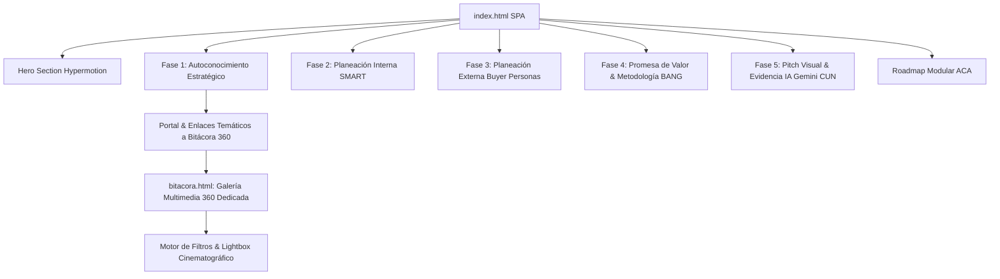

# 📋 BITÁCORA Y DOCUMENTACIÓN INTEGRAL DE LA SOLUCIÓN
# MARCA PERSONAL • ALDAIR ENRIQUE CAMARGO VILLALOBOS ("KIKE JUNIOR")
> **Corporación Unificada Nacional de Educación Superior (CUN)**  
> **Asignatura:** Proyecto de Vida (ACA)  
> **Programa Académico:** Ingeniería de Sistemas  
> **Estudiante:** Aldair Enrique Camargo Villalobos  
> **Docente / Guía:** Corporación Unificada Nacional CUN  
> **Repositorio Oficial:** [github.com/enrique-camargo/marca-personal](https://github.com/enrique-camargo/marca-personal)  
> **Última Actualización:** 2026-10-27  
> **Estado:** Activo y en sincronización continua  

---

## 📌 0. REGLA PERMANENTE DE ACTUALIZACIÓN
> **COMPROMISO DE TRAZABILIDAD:**  
> Cada vez que se agregue una nueva función, se modifique un módulo, se cambie el diseño, se carguen fotos o se corrija código en este proyecto, **este documento (`BITACORA_SOLUCION.md`) debe actualizarse obligatoriamente**, registrando los cambios en la sección de [Historial de Cambios y Versiones](#-historial-de-cambios-y-versiones-changelog) y ajustando la sección temática correspondiente.

---

## 🎯 1. CONTEXTO GENERAL DEL PROYECTO

### 1.1 Propósito Académico y Profesional
El proyecto consiste en el diseño, desarrollo e implementación de la **Marca Personal Digital** de **Aldair Enrique Camargo Villalobos ("Kike Junior")**, integrando de manera sinérgica sus dos grandes pasiones y pilares de vida:
1. **El Deporte de Alto Rendimiento (Voleibol):** Capitán y colocador (*setter*), aportando visión periférica, anticipación táctica, liderazgo bajo presión y armado de juego.
2. **La Ingeniería de Sistemas:** Automatización de procesos empresariales, desarrollo de software, gestión de infraestructura/servidores y aplicación ética de Inteligencia Artificial.

### 1.2 Filosofía de Diseño: "De la Cancha al Código"
La web no es un simple currículum estático; es una **Single Page Application (SPA)** inmersiva diseñada con estética **Dark Tech & Sports Strategy (Hypermotion Edition)**:
* Paleta cromática: `slate-950` (profundidad cyber), `cyan-400` (precisión tecnológica), `emerald-400` (vitalidad y rendimiento atlético) y acentos púrpura/ámbar.
* Tipografías modernas: `Outfit` (títulos y acentos), `Space Grotesk` (cuerpo técnico) y `JetBrains Mono` (telemetría y código).
* Interactividad viva: GSAP 3, ScrollTrigger, 3D Magnetic Tilt, Canvas de partículas cyber y Lightbox cinematográfico 360°.

---

## 🧩 2. ESTRUCTURA COMPLETA DE LA SOLUCIÓN (MÓDULO POR MÓDULO)



---

### 2.1 Hero Section: Portada y Primera Impresión (Hypermotion Live)
* **Lema Central:** *"Conecto personas, automatizo procesos y estructuro soluciones tecnológicas con la precisión estratégica de un colocador en la cancha."*
* **Badge Táctico:** Indicador de estado en tiempo real (`Colocador & Tech Lead • CUN 2026`).
* **Live Story Reel (3 Cards de Acceso Rápido):**
  1. *En Cancha:* Fotografía de Kike en pleno salto/armado de voleibol.
  2. *En Oficina (OSCORP):* Fotografía real en su puesto tecnológico.
  3. *En Viajes:* Fotografía de equilibrio personal en la naturaleza.
* **Pills de Competencia:** `#IngenieríaDeSistemas`, `#Automatización`, `#VoleibolSetter`, `#ResoluciónDeProblemas`.

---

### 2.2 Fase 1: Autoconocimiento Estratégico (ACA Fase 1)
Desarrollo profundo de introspección personal y profesional:
* **¿Quién Soy?:** Esencia orientada a la lógica, los deportes, la informática y la superación continua.
* **Test Oficial IKIGAI (Visualización Directa):**
  * Gráfico original renderizado en tarjeta destacada (`assets/IKIGAItest.png`).
  * **YO AMO (Pasión y Propósito):** Resolver problemas y tareas complejas usando habilidades analíticas naturales para ver resultados directos y tangibles.
  * **SOY BUENO PARA (Fortalezas):** Interactuar con computadoras, procesar información, organizar, planificar, priorizar y actividad física de alto rendimiento.
  * **EL MUNDO NECESITA (Vocación & Impacto):** Ingeniería, tecnología, matemáticas, telecomunicaciones y servicio técnico humano.
  * **Arquetipo & Rareza:** *Técnico Analista* • *Astucia Independiente*.
  * **Acción interactiva:** Clic en la imagen para abrir en modal ampliado de alta resolución con descripción guiada.
* **Retos Personales y Plan de Mejora:** Reconocimiento de la dificultad para decir 'no' ante solicitudes múltiples, con plan de mitigación basado en matrices Eisenhower y delimitación de alcance.
* **Medidor de Dimensiones CUN:**
  * *Dimensión Altamente Desarrollada (90%):* Cognitiva, Lógica-Matemática y Visión Espacial.
  * *Dimensión a Fortalecer (60%):* Hábito Lector Continuo e Inteligencia Intrapersonal.
* **5 Habilidades Distintivas:**
  1. *Liderazgo Táctico (Mentalidad de Colocador):* Armar el juego para que el rematador brille.
  2. *Resolución de Problemas:* Descomposición algorítmica de fallos complejos.
  3. *Automatización de Procesos:* Eliminación de fricciones repetitivas mediante código.
  4. *Organización Estructural:* Trazabilidad y arquitectura limpia de sistemas.
  5. *Escucha Activa y Negociación:* Comunicación asertiva en entornos multidisciplinarios.

---

### 2.3 Fase 2: Planeación Interna - Objetivos SMART Reales (ACA Fase 2)
Basados en la realidad laboral y académica de Kike Junior:
* **Showcase con Fotografía Real:** Foto de Kike en OSCORP con telemetría visual de servidores y procesos.
* **Meta Central Integral:**
  1. **Soluciones Corporativas:** Diseñar, desarrollar e implementar **4 soluciones tecnológicas** para automatizar, digitalizar y gestionar diferentes procesos en OSCORP, garantizando trazabilidad total.
  2. **Infraestructura:** Liderar la actualización y repotenciación integral de los **servidores corporativos** de la firma.
  3. **Formación Académica:** Culminar con éxito los **3 ciclos propedéuticos** de Ingeniería de Sistemas en la CUN, con formación permanente y certificada en buenas prácticas de Inteligencia Artificial.
* **Desglose de Criterios SMART:**
  * **S (Específico):** 4 herramientas digitales con firma/trazabilidad, migración de servidores y titulación CUN.
  * **M (Medible):** Reducción de tiempos manuales en un 60%, 99.9% uptime de servidores, 100% materias aprobadas.
  * **A (Alcanzable):** Aplicando infraestructura existente, frameworks web modernos y asesoría técnica directa.
  * **R (Relevante):** Conecta el avance profesional con el ascenso y valor agregado directo en su empleo.
  * **T (Temporal):** Planificado en sprints trimestrales a 6 y 12 meses.

---

### 2.4 Fase 3: Planeación Externa - Buyer Personas Reales (ACA Fase 3)
Sistema interactivo de pestañas con dos arquetipos auténticos:
* **A) Perfil Corporativo: Dra. Gwen Stacy (Representante Legal - Corporación OSCORP)**
  * *Dolor Crítico:* Firma física a papel y lápiz de documentos jurídicos, riesgo de extravío, demoras operativas y falta de trazabilidad.
  * *Solución Propuesta por Kike:* **App de Firma Digital y Gestión Documental Certificada** con opciones parametrizadas de **Aprobación**, **Suspensión** y **Abstención**, con auditoría de cambios y log cronológico.
* **B) Perfil Familiar y Bienestar: May Parker (Nombre Ficticio) (Mamá de Kike Junior)**
  * *Fotografía Real:* Foto entrañable de Kike junto a su madre (May Parker).
  * *Dolor Crítico:* Dificultad para planificar menús saludables, control deficiente de la despensa doméstica y falta de seguimiento histórico de hábitos sanos.
  * *Solución Propuesta por Kike:* **NutriTrack Home App**, aplicación móvil con recetario saludable, semáforo de inventario en alacena y gráficas de progreso de bienestar familiar en el tiempo.

---

### 2.5 Fase 4: Promesa de Valor & Metodología BANG (ACA Fase 4)
* **Fórmula de Promesa de Valor Oficial CUN:**
  > *"Yo, **Aldair Enrique Camargo (Kike Junior)**, sé **estructurar, desarrollar y automatizar soluciones tecnológicas**, para **equipos de desarrollo y organizaciones que buscan eficiencia y orden**, con **la visión estratégica, agilidad mental y liderazgo colaborativo de un colocador en la cancha de voleibol**."*
* **Split Interactivo "De la Cancha al Código":**
  * Lado A (Cancha): Foto de colocador armando juego táctico.
  * Lado B (Código): Foto en estación de trabajo programando soluciones.
* **Aplicación Oficial de la Metodología BANG:**
  * *Problema Analizado:* Fricción en firmas jurídicas manuales en papel.
  * *Jerarquía de Maslow:* **Necesidades de Seguridad** (certeza jurídica, no repudio y protección de datos).
  * *Guía Arquetípica:* **Cesia** (orden, rigor, blindaje y estructura).
  * *Tarjeta BANG:* *"Rompe los Miedos: Elimina la fricción operativa y crea confianza indestructible."*
  * *Acción Disruptiva:* **"LegalSign & Track 360: De la Cancha al Código"**.

---

### 2.6 Fase 5: Pitch Visual & Evidencia de Uso Ético de IA (ACA Fase 5)
* **Pitch Visual Ejecutivo:** Presentación tipo elevator pitch de 60 segundos orientada a empleadores y socios estratégicos.
* **Uso Ético de IA Generativa:**
  * *Herramienta Institucional:* Google Gemini (cuenta CUN).
  * *Registro de Prompts:* Documentación de directrices para refinamiento de textos y esquemas.
  * *Reflexión Crítica (140 palabras exactas):* Declaración de autoría, ética profesional y pensamiento crítico, donde la IA funge como asistente de aceleración y el estudiante ejerce la decisión y criterio técnico final.

---

### 2.7 Bitácora Multimedia 360° (Página Dedicada `bitacora.html` & Portal en Autoconocimiento)
Galería dinámica completa con **29 fotografías auténticas** (28 de la carpeta `YO` + 1 retrato oficial principal cyber tech), accesible como enlace interactivo dentro de la **Fase 1: Autoconocimiento** y alojada en su propia página web de alto rendimiento:
* **Integración en Autoconocimiento (`index.html`):**
  * Portal visual con badge `Bitácora Visual 360° • Material Real`, título `La Vida en Hypermotion` y texto descriptivo integral.
  * Chips de categoría que operan como enlaces directos parametrizados hacia `bitacora.html?filter=...` (*Todas (29)*, *Voleibol (4)*, *Laboral & Tech (3)*, *Viajes & Balance (12)*, *Familia (4)* y *Raíces & Niñez (6)*).
  * Botón principal de acceso a nueva página: *"Explorar Bitácora 360° en Otra Página"*.
  * Barra de acceso directo al pie de las 4 tarjetas de muestra en la pestaña "Mi Esencia & Pasiones".
  * Identificador retrocompatible `id="galeria-360"` para navegaciones de scroll.
* **Página Independiente (`bitacora.html`):**
  * **🏐 Voleibol Táctico (4 fotos):** Campeonatos, armado en salto, trofeos y sinergia de equipo.
  * **💻 Laboral & Sistemas (3 fotos):** Retrato oficial principal, servidores y puesto de desarrollo en OSCORP.
  * **🌍 Viajes & Equilibrio (12 fotos):** Rutas, naturaleza, montañas y momentos de reflexión.
  * **👨‍👩‍👧 Familia & Raíces (4 fotos):** Celebraciones familiares, unión y momentos con su madre May Parker (Nombre Ficticio).
  * **👶 Niñez & Orígenes (6 fotos):** Primeros años de vida, donde nació la pasión deportiva y la curiosidad técnica.
  * **Filtros Dinámicos con Detección de URL:** Lee parámetros `?filter=categoria` o `#categoria` al cargar para filtrar automáticamente.
  * **Lightbox Cinematográfico:** Modal interactivo con imagen ampliada, títulos, descripciones, contador (`1 / 29`), soporte para gestos táctiles y teclado (`Esc`, `←`, `→`).
  * **Navegación de Retorno:** Barra superior con botón directo *"Volver a Autoconocimiento"* que regresa a `index.html#fase-autoconocimiento`.

---

## 🛠️ 3. ARQUITECTURA TÉCNICA Y COMPONENTES

| Componente | Tecnología | Propósito |
| :--- | :--- | :--- |
| **Estructura** | HTML5 Semántico | SPA con accesibilidad, etiquetas meta y jerarquía limpia. |
| **Estilos & Diseño** | Tailwind CSS (CDN) | Utilidades de micro-espaciado, gradientes oscuros y paleta personalizada. |
| **Animación Base** | GSAP 3 & ScrollTrigger | Animación de entrada por scroll (*reveals* y *stagger* cinemático). |
| **Micro-interacciones 3D** | Vanilla JavaScript | 3D Magnetic Tilt en tarjetas con cálculo de ángulos en `mousemove`. |
| **Efectos de Partículas** | HTML5 Canvas API | Lienzo en segundo plano con nodos cyber interconectados flotantes. |
| **Tipografía** | Google Fonts | `Outfit`, `Space Grotesk`, `JetBrains Mono`. |
| **Iconografía** | FontAwesome 6 Free | Íconos de voleibol, código, servidores, familia, viajes y controles. |
| **Visor Modal (Lightbox)** | JavaScript Nativo | Modal único flotante con navegación secuencial, soporte táctil y teclado (`Esc`, `←`, `→`). |
| **Despliegue & Git** | GitHub Pages / Repo | Control de versiones distribuido con script `actualizar.bat`. |

---

## 📂 4. ESTRUCTURA DE ARCHIVOS DEL PROYECTO

```text
c:\CUN\Proyecto de VIDA\ACA\KIKE JUNIOR\
│
├── .gitignore                      # Exclusiones de Git
├── README.md                       # Documentación introductoria del repositorio
├── BITACORA_SOLUCION.md            # [ESTE ARCHIVO] Documentación integral y registro continuo
├── actualizar.bat                  # Script interactivo de un solo clic para Git Add, Commit y Push
├── index.html                      # Single Page Application principal (Fases 1 a 5 y Portal a Bitácora 360)
├── bitacora.html                   # [NUEVA PÁGINA DEDICADA] Bitácora Visual 360° (29 Fotos, Filtros y Lightbox)
├── index_v3_backup.html            # [COPIA DE RESPALDO] Versión previa 3.2 preservada
│
└── assets/                         # Directorio de recursos estáticos
    ├── kike_principal.jpg          # [FOTO PRINCIPAL OFICIAL] Retrato cyber tech oficial
    ├── kike_tech_leader.jpg        # [NUEVA FOTO] Retrato cinematográfico como Líder de Equipo de Sistemas
    ├── IKIGAItest.png              # Gráfico oficial del Test IKIGAI
    ├── yo/                         # Galería fotográfica auténtica (28 fotos)
    │   ├── Voleibol/               # 4 fotos deportivas
    │   ├── Laboral/                # 2 fotos en OSCORP + 1 foto Tech Lead
    │   ├── Familia/                # 4 fotos familiares y madre
    │   ├── Viajes/                 # 12 fotos de viajes y naturaleza
    │   └── Ninez/                  # 6 fotos de infancia y orígenes
```

---

## 📜 5. HISTORIAL DE CAMBIOS Y VERSIONES (CHANGELOG)

### [Versión 4.6] - 2026-10-27 (Protección de Datos y Anonimización de Nombres de Terceros y Empresas) 🛡️🔒
* **Sustitución de Nombres Reales de Terceros y Organizaciones por Nombres Ficticios:**
  * **Organización / Empresa Corporativa:** Se reemplazaron todas las referencias al nombre real de la empresa por **"OSCORP"** (en la portada, Autoconocimiento, objetivos SMART, Buyer Persona, Promesa de Valor, Pitch Visual, Reflexión de IA y Bitácora 360°).
  * **Buyer Persona 1 (Perfil Corporativo):** Se actualizó el nombre a **"Dra. Gwen Stacy"** (con iniciales `GS` en el avatar corporativo), manteniendo intacto el caso de uso real de automatización de firma jurídica en **OSCORP**.
  * **Buyer Persona 2 (Perfil Familiar):** Se actualizó el nombre de su madre al nombre ficticio **"May Parker"** (en armonía con la temática Marvel del autor), preservando el caso de uso de *NutriTrack Home App*.
  * **Bitácora Visual 360° & Textos Alternativos:** Se actualizaron las descripciones y etiquetas `alt` de las fotografías familiares y laborales tanto en [`index.html`](index.html) como en [`bitacora.html`](bitacora.html) y en la documentación del repositorio para no exponer nombres reales de terceros ni de compañías.

### [Versión 4.5] - 2026-10-27 (Generación y Calibración Fiel: Líder de Equipo en Sistemas y Tecnología) 👨‍💻🚀
* **Generación y Calibración Fiel de Imagen de Liderazgo Tecnológico:**
  * Tomando como referencia directa la fisionomía exacta de Kike Junior en `assets/kike_principal.jpg` y la carpeta `assets/yo/Laboral/`, se calibró la generación para respetar estrictamente sus rasgos auténticos: cabello lacio oscuro peinado hacia atrás, rostro ovalado despejado, tez trigueña clara, ojos almendrados y sonrisa serena con labios cerrados.
  * **Concepto Visual:** Kike Junior posicionado en el centro como **Líder de Equipo (Tech Lead / Systems Engineering Lead)**, al frente de un equipo multidisciplinario de ingenieros de software e infraestructura en un moderno centro de operaciones TI con pantallas de código, monitores con telemetría cloud y estética Dark Tech con acentos cian y esmeralda.
  * **Archivos Almacenados:** Guardado y actualizado en [`assets/yo/Laboral/kike_tech_leader.jpg`](assets/yo/Laboral/kike_tech_leader.jpg) y [`assets/kike_tech_leader.jpg`](assets/kike_tech_leader.jpg).

### [Versión 4.4] - 2026-10-27 (Desacoplamiento de Bitácora 360° en Página Dedicada & Portal en Autoconocimiento) 📸🌐
* **Desacoplamiento a Página Dedicada (`bitacora.html`):**
  * Se trasladó la galería multimedia completa de 29 fotografías a un archivo independiente [bitacora.html](file:///c:/CUN/Proyecto%20de%20VIDA/ACA/KIKE%20JUNIOR/bitacora.html), aligerando la carga de [index.html](file:///c:/CUN/Proyecto%20de%20VIDA/ACA/KIKE%20JUNIOR/index.html) y proporcionando un espacio enfocado y de alta fidelidad visual.
  * Preserva todas las características de diseño: paleta *Dark Tech & Sports Strategy*, partículas reactivas canvas, efecto 3D Magnetic Tilt, encuadre Face-Safe (`object-top`), badges de categoría y Lightbox cinematográfico con soporte de teclado (`Esc`, `←`, `→`).
  * **Detección inteligente de URL:** La página lee automáticamente parámetros `?filter=categoria` o `#categoria` para prefiltrar la galería en el momento de la carga.
  * **Barra de Navegación con Retorno Seguro:** Incluye botón destacado `← Volver a Autoconocimiento` que regresa al usuario exactamente a `#fase-autoconocimiento` en la página principal.
* **Integración de Enlace / Portal dentro de "Autoconocimiento" (`index.html`):**
  * Se integró en la sección de Autoconocimiento el bloque solicitado por el usuario:
    * Badge: `Bitácora Visual 360° • Material Real`
    * Título: `La Vida en Hypermotion`
    * Párrafo descriptivo: *"Más visual, más viva y 100% auténtica: explora los 28 momentos que forjan mi carácter, mi rigor deportivo en la cancha, mis soluciones de ingeniería en OSCORP y el balance vital con mi familia."*
    * Botones interactivos de categoría como enlaces directos: `Todas (29)`, `Voleibol (4)`, `Laboral & Tech (3)`, `Viajes & Balance (12)`, `Familia (4)`, `Raíces & Niñez (6)` apuntando a `bitacora.html?filter=...`.
    * Botón de llamada a la acción: `Explorar Bitácora 360°`.
  * Se conservó únicamente la tarjeta principal de Bitácora 360° dentro de Autoconocimiento (removiendo barras secundarias duplicadas para máxima elegancia visual).
  * Se asignó el id `galeria-360` a la tarjeta dentro de Autoconocimiento para garantizar retrocompatibilidad total con anclajes previos.
* **Limpieza y Optimización de la Navegación:**
  * Se actualizaron los enlaces del Navbar superior y del menú móvil para apuntar a `bitacora.html`.
  * Se eliminaron fragmentos duplicados en el Navbar desktop y en la cuadrícula del Roadmap.
  * Se removió la sección estática pesada del pie de `index.html`, dejando el flujo narrativo limpio: *Hero → Autoconocimiento (con portal a Bitácora 360) → SMART → Buyer Persona → Promesa BANG → Pitch Visual IA → Roadmap → Footer*.

### [Versión 4.3] - 2026-10-20 (Actualización de Evidencia Familiar: Con mi FAMILIA) 👨‍👩‍👧‍👦❤️
* **Actualización de Título y Descripción en la Evidencia 8 de 29:**
  * Se actualizó la tarjeta de la galería y los metadatos del visor interactivo Lightbox para la fotografía familiar (`assets/yo/Familia/IMG-20251018-WA0038.jpg`).
  * **Título actualizado:** `"Con mi FAMILIA"`.
  * **Descripción:** `"Mi núcleo familiar: el motor, apoyo e inspiración detrás de cada meta."`.
  * **Texto alternativo (alt):** `"Con mi FAMILIA - Mi núcleo familiar"`.

### [Versión 4.2] - 2026-10-20 (Restauración de Arquitectura Favorita & Precisión de 1er Ciclo) 🛡️🎓
* **Restauración a la Estructura Favorita del Backup (`index_v3_backup.html`):**
  * Se restableció la estructura completa amada por el usuario con:
    1. **B) Dimensiones del Ser Humano:** Balance integral visual (90% Cognitiva, Lógica-Matemática y Espacial vs 60% Hábito Lector Profundo e Intrapersonal).
    2. **C) Mis 5 Habilidades Distintivas:** Tarjetas de Liderazgo Táctico, Resolución de Problemas, Automatización, Organización y Escucha Activa.
    3. **Objetivo Profesional SMART:** Showcase en vivo en OSCORP con la fotografía real de equipo, declaración de meta y el grid completo de 5 dimensiones S-M-A-R-T.
    4. **Test Oficial IKIGAI:** Diagrama interactivo con 4 cuadrantes.
* **Aclaración Académica Rigurosa (Ciclos Propedéuticos):**
  * Corrección fundamental de avance: Kike Junior **está cursando actualmente el 1er Ciclo Propedéutico: Técnico Profesional en Sistemas (CUN)**.
  * Se corrigió la redacción en la meta SMART y en el desglose para eliminar cualquier mención de "culminado", reflejando con exactitud su estatus como estudiante activo del primer ciclo con proyección hacia el título Tecnológico y Profesional.
* **Integración de la Fotografía Principal Oficial (`assets/kike_principal.jpg`):**
  * La imagen oficial de estudio cyber tech preside el **Hero HUD** como la foto más destacada con esquinas tácticas, badge `Colocador & Tech Lead` y resplandor neón.
  * Incorporada como avatar en el Navbar superior y como retrato en el Elevator Pitch (Fase 5).
  * Incluida como la **pieza #1 destacada** en la Galería 360 con badge `Principal ⭐`.
* **Solución de Carga en las 28+ Evidencias Reales:**
  * Se corrigió la carga de las evidencias restableciendo el renderizado estático del grid, asegurando que las 29 tarjetas fotográficas carguen de inmediato sin quedar ocultas y aplicando encuadre Face-Safe (`object-top`) en todos los retratos para no cortar rostros.

### [Versión 4.1] - 2026-10-20 (Foto Principal Oficial Cyber Tech) 🌟🎯
* **Incorporación de Fotografía Oficial:** Se integró el retrato profesional definitivo de Kike Junior (`assets/kike_principal.jpg`), con brazos cruzados, camisa corporativa y fondo de centro de comando tecnológico con circuitos de neón cian.
* **Configuración como Pieza Central y Más Destacada:**
  1. **Hero Section:** Portada principal coronada con resplandor glow de neón cian-esmeralda, badge animado `FOTO PRINCIPAL OFICIAL`, título de *Tech Lead* y telemetría de *OSCORP*.
  2. **Barra de Navegación (Header):** Avatar circular con anillo orbital animado y borde de neón junto al logotipo interactivo `<KJ/>`.
  3. **Fase 5 (Pitch Visual):** Retrato ejecutivo oficial acompañando la propuesta de valor y el simulador de ecualizador de audio de 60 segundos.
  4. **Bitácora Multimedia 360°:** Elemento #1 de la galería como joya de la corona con badge `Foto Principal ⭐`.
  5. **Modo Conmutador Táctico:** Modo *Ingeniero & Tech Lead* configurado como el estado activo por defecto para mostrar inmediatamente esta imagen al ingresar.

### [Versión 4.0] - 2026-10-20 (Visual Hypermotion & Face-Safe Edition) 🚀⚡
* **Copia de Respaldo Generada:** Creación y preservación de `index_v3_backup.html` para garantizar la integridad histórica del código previo por si se desea revertir.
* **Análisis de Encuadre Seguro (Face-Safe Framing):**
  * Se analizó la orientación y posición de rostros de las 28 fotografías.
  * Se eliminó el recorte de cabezas y rostros aplicando `object-top` en fotografías verticales y contenedores con relación de aspecto calculada (`aspect-[3/4]`, `aspect-[4/5]`, `aspect-[16/10]`), así como `object-contain` en imágenes de aspecto extremo.
* **Reducción de Texto y Síntesis Visual:**
  * Se eliminaron los párrafos densos, sustituyéndolos por **telemetría de tarjetas**, **chips de datos**, **métricas de impacto** y **resúmenes escaneables**.
* **Mayor Presencia Fotográfica en Todos los Módulos:**
  * **Hero Section:** Integración de un **Live Story Reel con 5 tarjetas interactivas** (Voleibol, Laboral, Familia con Mamá, Viajes y Orígenes).
  * **Fase 1 (Autoconocimiento):** Nuevo **Tríptico de Identidad** con 3 fotos reales a gran escala (El Atleta, El Ingeniero y Los Cimientos) y el gráfico del Test IKIGAI con 4 cuadrantes interactivos.
  * **Fase 2 (SMART):** Showcase dual con fotos reales de la estación de trabajo en OSCORP y telemetría de servidores.
  * **Fase 3 (Buyer Persona):** Incorporación de **dos fotografías reales con su madre May Parker (Nombre Ficticio)** con encuadre de rostro perfecto y mockups interactivos de NutriTrack Home y Firma Legal.
  * **Fase 4 (Promesa de Valor):** Split visual interactivo "De la Cancha al Código" con fotos de armado en salto vs estación de desarrollo.
  * **Fase 5 (Pitch Visual):** Tarjeta ejecutiva con retrato profesional y simulador de reproductor con ecualizador de audio animado.
  * **Bitácora 360°:** Visualizador con las 28 fotos con encuadre calculado, badges de categoría y Lightbox secuencial con teclado.
* **Nuevo Emblema de Marca (<KJ/>):**
  * Emblema vectorial SVG con hexágono giratorio táctico, líneas de balón de voleibol y corchetes de programación.
* **Efectos de Sonido Cyber (Web Audio API):**
  * Sintetizador de audio nativo y offline para clics y transiciones, con botón conmutador de activación/silencio.
* **Contadores Animados en Vivo:**
  * Implementación de contadores numéricos interactivos mediante GSAP ScrollTrigger (+10 años, 4 soluciones, 99.9% uptime, 3 ciclos, 28 fotos).
* **Conmutador Táctico en Tiempo Real:**
  * Selector interactivo en el Hero entre "Modo Atleta: Colocador #7" y "Modo Ingeniero: Full-Stack & Ops", que cambia la telemetría y foto en vivo.

### [Versión 3.2] - 2026-10-20
* **Agregado:** Creación formal de la bitácora integral del proyecto (`BITACORA_SOLUCION.md`) como fuente de verdad y registro de todas las decisiones, arquitecturas y módulos.
* **Regla Establecida:** Obligatoriedad de registrar cualquier actualización futura en este documento.

### [Versión 3.1] - 2026-10-20
* **Corregido:** Visualización directa y destacada del gráfico del **Test IKIGAI** (`assets/IKIGAItest.png`) en la Fase 1, con tarjeta estética, desglose de resultados (Yo Amo, Soy Bueno Para, El Mundo Necesita) y botón de ampliación.
* **Corregido:** Reparación del modal Lightbox (`openImageModal` y `openGalleryLightbox`). Se eliminó un bloque duplicado de HTML que creaba IDs duplicados y causaba errores `null reference` en la consola.
* **Mejorado:** Asignación de `z-index: 9999` y backdrop-blur al visor modal, agregando soporte de navegación con teclas de flecha (`←`, `→`) y cierre con `Esc`.
* **Sincronizado:** Subida limpia y exitosa al repositorio GitHub (`commit 3350e84`).

### [Versión 3.0] - 2026-10-20
* **Agregado:** Integración completa de la carpeta `YO` con **28 fotografías reales** en alta definición.
* **Agregado:** Creación de la sección **Bitácora Multimedia 360°** (`#galeria-360`) con 5 categorías filtrables: *Voleibol*, *Laboral*, *Viajes*, *Familia* y *Niñez*.
* **Agregado:** Implementación del **Split Interactivo "De la Cancha al Código"** en la Promesa de Valor.
* **Agregado:** Canvas interactivo de partículas cyber dinámicas con estela reactiva.
* **Agregado:** Efecto 3D Magnetic Tilt en tarjetas interactivas de evidencia y objetivos.

### [Versión 2.0] - 2026-10-20
* **Agregado:** Integración de los datos reales del 2do Avance ACA:
  * Objetivos SMART reales: 4 soluciones corporativas, servidores OSCORP y 3 ciclos propedéuticos CUN.
  * Buyer Personas reales: Dra. Gwen Stacy (Firma Digital) y May Parker (Nombre Ficticio) (NutriTrack Home).
  * Promesa de valor basada en la analogía del colocador de voleibol.
  * Reflexión ética del uso de IA (Gemini CUN) ajustada al estándar institucional de 140 palabras.
* **Agregado:** Script automatizado `actualizar.bat` con soporte UTF-8 para commit y push directos.

### [Versión 1.0] - 2026-10-20
* **Inicial:** Estructura inicial de Single Page Application para Proyecto de Vida (ACA) CUN.
* **Diseño:** Implementación del sistema de diseño dark tech, módulos de autoconocimiento, radar de habilidades y formulario interactivo.

---

## 🔮 6. GUÍA RÁPIDA PARA FUTURAS MODIFICACIONES
Cuando se requiera hacer un cambio en la página web:
1. **Modificar el código fuente:** En [index.html](file:///c:/CUN/Proyecto%20de%20VIDA/ACA/KIKE%20JUNIOR/index.html).
2. **Actualizar esta bitácora:** Registrar la modificación en [BITACORA_SOLUCION.md](file:///c:/CUN/Proyecto%20de%20VIDA/ACA/KIKE%20JUNIOR/BITACORA_SOLUCION.md) sumando un nuevo registro al *Changelog* y ajustando el contenido temático.
3. **Publicar en GitHub:** Ejecutar en terminal o mediante `actualizar.bat`:
   ```cmd
   git add .
   git commit -m "Descripcion clara de lo actualizado"
   git push origin main
   ```
